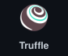
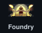
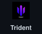
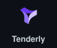
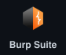
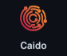
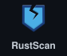
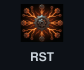

  <h1></h1>
  <h3><b>Smart Contract Security Researcher | Blockchain Developer</b></h3>
  

    
  

  

    I'm a <b>security-first blockchain engineer</b> who finds logic flaws in smart contracts and builds secure decentralized infrastructure.
  

  

    I'm an <b>Ackee Blockchain Solana Alum</b>, <b>Alchemy University Alum</b>, <b>HTB Elite hacker</b>, <b>Global Top 1% TryHackMe researcher</b> and <b>bug bounty hunter</b>.
    I bridge development and offensive security: I write clean smart contracts and full-stack DApps, and I audit Solana and EVM code for exploit vectors.
    My methodology follows the <a href="https://swcregistry.io/">Smart Contract Weakness Classification (SWC)</a> standard.
  

### Languages & Stack

### Smart Contract Security Toolkit

### General-Purpose Pentesting Tools

  <h3>MVP Projects</h3>

  
  

  <i>W3RS-Web3-Research-Security-Playground Part 1</i>
  &nbsp;&nbsp;&nbsp;&nbsp;&nbsp;&nbsp;&nbsp;&nbsp;&nbsp;&nbsp;&nbsp;&nbsp;&nbsp;&nbsp;&nbsp;&nbsp;&nbsp;&nbsp;&nbsp;&nbsp;&nbsp;&nbsp;&nbsp;&nbsp;&nbsp;&nbsp;&nbsp;&nbsp;&nbsp;&nbsp;&nbsp;&nbsp;&nbsp;&nbsp;&nbsp;&nbsp;
  <i>W3RS-Web3-Research-Security-Playground Part 2</i>

  
  

  <i>W3RS-Web3-Research-Security-Playground Part 3</i>
  &nbsp;&nbsp;&nbsp;&nbsp;&nbsp;&nbsp;&nbsp;&nbsp;&nbsp;&nbsp;&nbsp;&nbsp;&nbsp;&nbsp;&nbsp;&nbsp;&nbsp;&nbsp;&nbsp;&nbsp;&nbsp;&nbsp;&nbsp;&nbsp;&nbsp;&nbsp;&nbsp;&nbsp;&nbsp;&nbsp;&nbsp;&nbsp;&nbsp;&nbsp;&nbsp;&nbsp;
  <i>W3RS-Web3-Research-Security-Playground Part 4</i>

  
  

  <i>RIA R3-w1red-4rch</i>
  &nbsp;&nbsp;&nbsp;&nbsp;&nbsp;&nbsp;&nbsp;&nbsp;&nbsp;&nbsp;&nbsp;&nbsp;&nbsp;&nbsp;&nbsp;&nbsp;&nbsp;&nbsp;&nbsp;&nbsp;&nbsp;&nbsp;&nbsp;&nbsp;&nbsp;&nbsp;&nbsp;&nbsp;&nbsp;&nbsp;&nbsp;&nbsp;&nbsp;&nbsp;&nbsp;&nbsp;&nbsp;&nbsp;&nbsp;&nbsp;&nbsp;&nbsp;&nbsp;&nbsp;&nbsp;&nbsp;&nbsp;&nbsp;&nbsp;&nbsp;&nbsp;&nbsp;&nbsp;&nbsp;&nbsp;&nbsp;&nbsp;&nbsp;&nbsp;&nbsp;
  <i>My-linux-tools</i>

<!--
Optional sections to add later (remove these comment markers when you have real content):

### Selected Findings
| Date | Platform / Protocol | Finding | Severity | Report |
|------|---------------------|---------|----------|--------|
| YYYY-MM | Code4rena / Sherlock / Cantina / Immunefi | One-line description | High / Med | [link](https://) |

### Connect

-->
