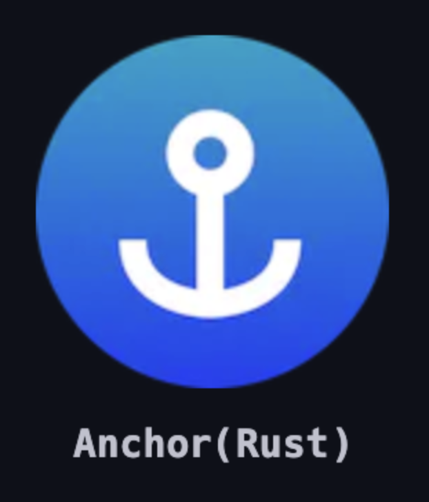
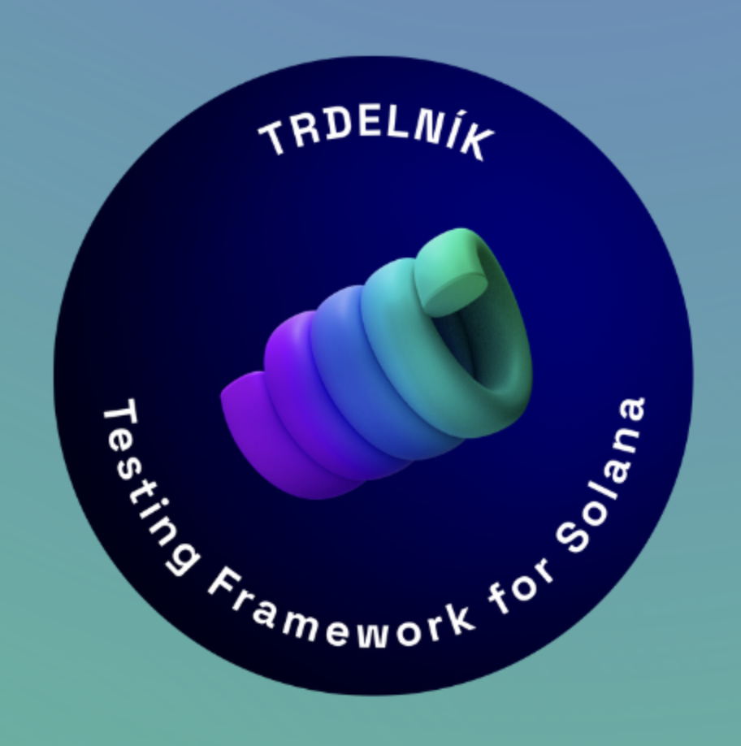
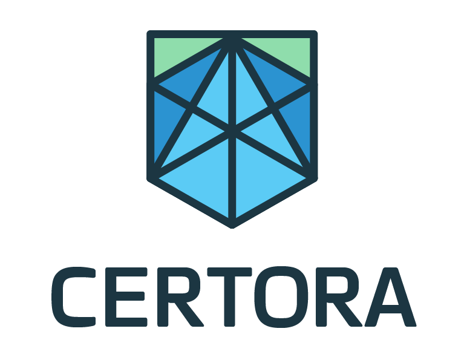
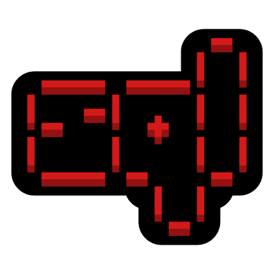

  <h1></h1>
  <h3><b>Smart Contract Security Researcher | Blockchain Developer</b></h3>
  

    
  

  

    I'm a <b>security-first blockchain engineer</b> who finds logic flaws in smart contracts and builds secure decentralized infrastructure.
  

  

    I'm an <b>Ackee Blockchain Solana Alum</b>, <b>Alchemy University Alum</b>, <b>HTB Elite hacker</b>, <b>Global Top 1% TryHackMe researcher</b> and <b>bug bounty hunter</b>.
    I bridge development and offensive security: I write clean smart contracts and full-stack DApps, and I audit Solana and EVM code for exploit vectors.
    My methodology follows the <a href="https://swcregistry.io/">Smart Contract Weakness Classification (SWC)</a> standard.
  

### Languages & Stack

### Smart Contract Security Toolkit

<!-- Inline images wrap automatically: more rows on narrow screens, fewer on wide ones. -->

### General-Purpose Pentesting Tools

### Projects

<table>
  <tr>
    <td width="50%" align="center" valign="top">
      
       <b>W3RS Part 1: The Legendary Legacy</b> 
      Smart contract auditing practice ground for Solana and Ethereum, built around SWC vulnerabilities.
    </td>
    <td width="50%" align="center" valign="top">
      
       <b>W3RS Part 2: Commando &amp; Shinobi Operations</b> 
      New challenges and missions continuing the series.
    </td>
  </tr>
  <tr>
    <td width="50%" align="center" valign="top">
      
       <b>W3RS Part 3: The Shadow Protocol</b> 
      New blockchain challenges with a stealth-infiltration storyline.
    </td>
    <td width="50%" align="center" valign="top">
      
       <b>W3RS Part 4: Joint Operation</b> 
      The finale: everything compiled into one offline Web3 vulnerability practice ground.
    </td>
  </tr>
  <tr>
    <td width="50%" align="center" valign="top">
      
       <b>RIA R3-w1red-4rch</b> 
      Arch-based Linux distro for Web3 pentesting and general-purpose pentesting (arm64 and x86).
    </td>
    <td width="50%" align="center" valign="top">
      
       <b>My-linux-tool</b> 
      Penetration testing tools I've built, mostly in Python, Bash and Rust.
    </td>
  </tr>
</table>

### Proof of Work

| Repository | What's inside |
|---|---|
| [Web3Audits_Ethereum_Solana](https://github.com/SAMIR897/Web3Audits_Ethereum_Solana) | Smart contract auditing practice platforms and lab solutions, with a write-up for every challenge |
| [CTFs_Capture_The_Flags](https://github.com/SAMIR897/CTFs_Capture_The_Flags) | Write-ups from HTB, THM, TCM, Hacking Hub, PicoCTF and similar platforms |
| [Hackathons_Writeup](https://github.com/SAMIR897/Hackathons_Writeup) | Web3 hackathon projects, each with a detailed write-up |
| [Blockchain_Projects](https://github.com/SAMIR897/Blockchain_Projects) | Full-stack Ethereum and Solana projects, deployed on testnet with live links |
| [Rust_Projects](https://github.com/SAMIR897/Rust_Projects) | Native Rust projects, including CLI cybersecurity tools |
| [Python_projects](https://github.com/SAMIR897/Python_projects) | Python projects, mostly Tkinter GUIs, plus cybersecurity tools |

<!--
Add this when you have real bug bounty or contest results, then remove the comment markers:

### Selected Findings

| Date | Platform / Protocol | Finding | Severity | Report |
|------|---------------------|---------|----------|--------|
| YYYY-MM | Code4rena / Sherlock / Cantina / Immunefi | One-line description | High / Med | [link](https://) |

-->

### Connect

<!--
Add your own, then remove the comment markers:

-->

