

  <h1></h1>
  <h3><b>Smart Contract Security Researcher | Blockchain Developer</b></h3>
  

    
  

  

    I'm a <b>security-first blockchain engineer</b> who finds logic flaws in smart contracts and builds secure decentralized infrastructure.
  

  

    I'm an <b>Ackee Blockchain Solana Alum</b>, <b>Alchemy University Alum</b>, <b>HTB Elite hacker</b>, <b>Global Top 1% TryHackMe researcher</b> and <b>bug bounty hunter</b>.
    I bridge development and offensive security: I write clean smart contracts and full-stack DApps, and I audit Solana and EVM code for exploit vectors.
    My methodology follows the <a href="https://swcregistry.io/">Smart Contract Weakness Classification (SWC)</a> standard.
  

### Languages & Stack

### Smart Contract Security Toolkit

<a href="https://hardhat.org/">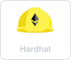</a>

<a href="https://www.getfoundry.sh/">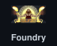</a>

<a href="https://github.com/Ackee-Blockchain/trident">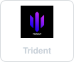</a>

<a href="https://github.com/crytic/slither">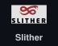</a>
<a href="https://github.com/Cyfrin/aderyn">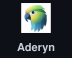</a>
<a href="https://github.com/ConsenSysDiligence/mythril">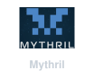</a>

<a href="https://etherscan.io/">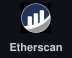</a>

### General-Purpose Pentesting Tools

<a href="https://caido.io/">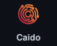</a>

<a href="https://sqlmap.org/">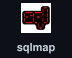</a>
<a href="https://github.com/projectdiscovery/nuclei">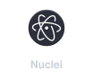</a>
<a href="https://github.com/projectdiscovery/subfinder">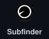</a>
<a href="https://github.com/RustScan/RustScan">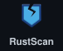</a>
<a href="https://github.com/SAMIR897/Rust_Subdomain_tool/">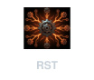</a>

<a href="https://www.kali.org/tools/hashcat/">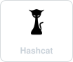</a>

### Projects

<table>
  <tr>
    <td width="50%" align="center" valign="top">
      
       <b>W3RS Part 1: The Legendary Legacy</b> 
      Smart contract auditing practice ground for Solana and Ethereum, built around SWC vulnerabilities.
    </td>
    <td width="50%" align="center" valign="top">
      
       <b>W3RS Part 2: Commando &amp; Shinobi Operations</b> 
      New challenges and missions continuing the series.
    </td>
  </tr>
  <tr>
    <td width="50%" align="center" valign="top">
      
       <b>W3RS Part 3: The Shadow Protocol</b> 
      New blockchain challenges with a stealth-infiltration storyline.
    </td>
    <td width="50%" align="center" valign="top">
      
       <b>W3RS Part 4: Joint Operation</b> 
      The finale: everything compiled into one offline Web3 vulnerability practice ground.
    </td>
  </tr>
  <tr>
    <td width="50%" align="center" valign="top">
      
       <b>RIA R3-w1red-4rch</b> 
      Arch-based Linux distro for Web3 pentesting and general-purpose pentesting (arm64 and x86).
    </td>
    <td width="50%" align="center" valign="top">
      
       <b>My-linux-tool</b> 
      Penetration testing tools I've built, mostly in Python, Bash and Rust.
    </td>
  </tr>
</table>

<!--
Optional sections to add later (remove these comment markers when you have real content):

### Selected Findings
| Date | Platform / Protocol | Finding | Severity | Report |
|------|---------------------|---------|----------|--------|
| YYYY-MM | Code4rena / Sherlock / Cantina / Immunefi | One-line description | High / Med | [link](https://) |

### Connect

-->
