

  <h1></h1>
  <h3><b>Smart Contract Security Researcher | Blockchain Developer</b></h3>
  

    
  

  

    I'm a <b>security-first blockchain engineer</b> who finds logic flaws in smart contracts and builds secure decentralized infrastructure.
  

  

    I'm an <b>Ackee Blockchain Solana Alum</b>, <b>Alchemy University Alum</b>, <b>HTB Elite hacker</b>, <b>Global Top 1% TryHackMe researcher</b> and <b>bug bounty hunter</b>.
    I bridge development and offensive security: I write clean smart contracts and full-stack DApps, and I audit Solana and EVM code for exploit vectors.
    My methodology follows the <a href="https://swcregistry.io/">Smart Contract Weakness Classification (SWC)</a> standard.
  

### Languages & Stack

### Smart Contract Security Toolkit

[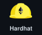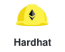](https://hardhat.org/)

[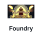](https://www.getfoundry.sh/)
[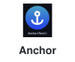](https://www.anchor-lang.com/)
[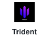](https://github.com/Ackee-Blockchain/trident)
[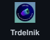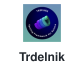](https://github.com/reastyn/trdelnik)
[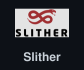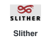](https://github.com/crytic/slither)
[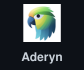](https://github.com/Cyfrin/aderyn)
[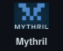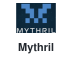](https://github.com/ConsenSysDiligence/mythril)
[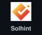](https://github.com/protofire/solhint)
[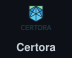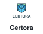](https://www.certora.com/)

[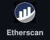](https://etherscan.io/)

### General-Purpose Pentesting Tools

[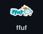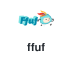](https://www.kali.org/tools/ffuf/)
[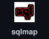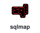](https://sqlmap.org/)
[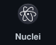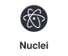](https://github.com/projectdiscovery/nuclei)
[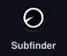](https://github.com/projectdiscovery/subfinder)

[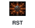](https://github.com/SAMIR897/Rust_Subdomain_tool/)
[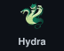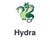](https://www.kali.org/tools/hydra/)
[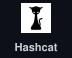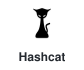](https://www.kali.org/tools/hashcat/)

  <h3>MVP Projects</h3>

  
  

  <i>W3RS-Web3-Research-Security-Playground Part 1</i>
  &nbsp;&nbsp;&nbsp;&nbsp;&nbsp;&nbsp;&nbsp;&nbsp;&nbsp;&nbsp;&nbsp;&nbsp;&nbsp;&nbsp;&nbsp;&nbsp;&nbsp;&nbsp;&nbsp;&nbsp;&nbsp;&nbsp;&nbsp;&nbsp;&nbsp;&nbsp;&nbsp;&nbsp;&nbsp;&nbsp;&nbsp;&nbsp;&nbsp;&nbsp;&nbsp;&nbsp;
  <i>W3RS-Web3-Research-Security-Playground Part 2</i>

  
  

  <i>W3RS-Web3-Research-Security-Playground Part 3</i>
  &nbsp;&nbsp;&nbsp;&nbsp;&nbsp;&nbsp;&nbsp;&nbsp;&nbsp;&nbsp;&nbsp;&nbsp;&nbsp;&nbsp;&nbsp;&nbsp;&nbsp;&nbsp;&nbsp;&nbsp;&nbsp;&nbsp;&nbsp;&nbsp;&nbsp;&nbsp;&nbsp;&nbsp;&nbsp;&nbsp;&nbsp;&nbsp;&nbsp;&nbsp;&nbsp;&nbsp;
  <i>W3RS-Web3-Research-Security-Playground Part 4</i>

  
  

  <i>RIA R3-w1red-4rch</i>
  &nbsp;&nbsp;&nbsp;&nbsp;&nbsp;&nbsp;&nbsp;&nbsp;&nbsp;&nbsp;&nbsp;&nbsp;&nbsp;&nbsp;&nbsp;&nbsp;&nbsp;&nbsp;&nbsp;&nbsp;&nbsp;&nbsp;&nbsp;&nbsp;&nbsp;&nbsp;&nbsp;&nbsp;&nbsp;&nbsp;&nbsp;&nbsp;&nbsp;&nbsp;&nbsp;&nbsp;&nbsp;&nbsp;&nbsp;&nbsp;&nbsp;&nbsp;&nbsp;&nbsp;&nbsp;&nbsp;&nbsp;&nbsp;&nbsp;&nbsp;&nbsp;&nbsp;&nbsp;&nbsp;&nbsp;&nbsp;&nbsp;&nbsp;&nbsp;&nbsp;
  <i>My-linux-tools</i>

<!--
Optional sections to add later (remove these comment markers when you have real content):

### Selected Findings
| Date | Platform / Protocol | Finding | Severity | Report |
|------|---------------------|---------|----------|--------|
| YYYY-MM | Code4rena / Sherlock / Cantina / Immunefi | One-line description | High / Med | [link](https://) |

### Connect

-->
